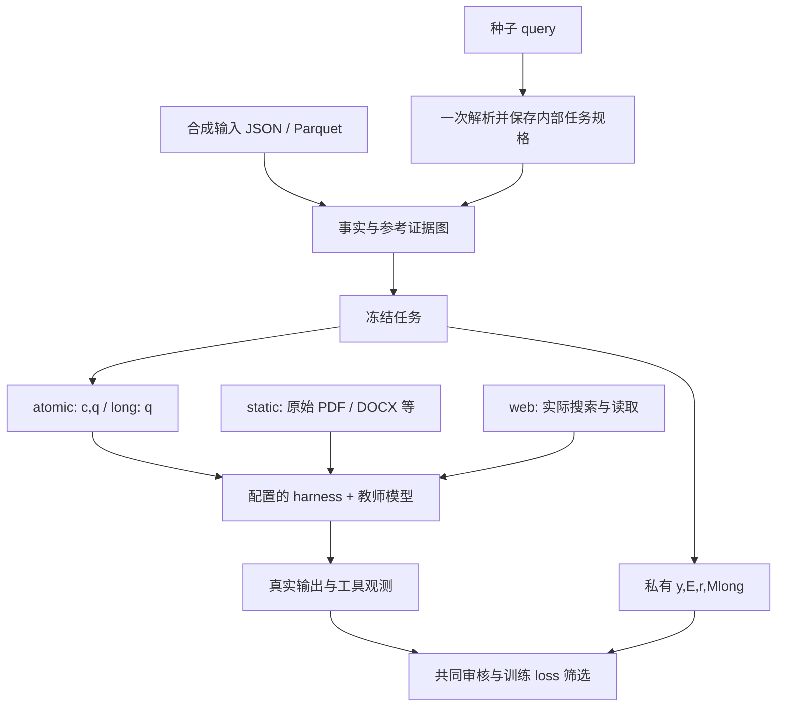

# 原始文档、联网取证与冻结任务重新采集

默认执行框架为 Codex，仍支持 Strands、Claude Code 和显式选择的旧 `native` JSON 动作循环。教师模型由 LLM role 独立配置。更换 harness 不改写 query、参考答案、参考证据、任务划分或审核标准；轨迹、实际作答、用量及由此产生的审核结果可以不同。



`static` 与 `web` 是互斥配置。静态目录由用户提供，示例中的 `../originals` 必须替换为实际目录。只合成 query、尚不采集轨迹时，可以先不提供目录；启用长程采集时会在执行前检查目录。

```yaml
harness:
  retrieval:
    mode: static
    corpus_path: /data/original_documents
    manifest_path: null
training:
  agent_runtime:
    default: codex
    codex:
      mode: native
```

静态工具 `search_documents/read_document` 读取原始文件，PDF 以页、DOCX 以段落或表格块定位，并允许继续读取同一文档其他位置。索引与文本解析不代替原文件。扫描 PDF 需要额外 OCR 适配；当前无可提取文本时明确返回错误。原始字节按内容哈希归档，只有实际返回的片段计入取得的证据。

不要求合成语料库与检索语料库整库配对，也不要求用户维护跨库映射表。同一来源可通过已有 URL、原文件哈希、原路径或可选 manifest 识别；不同来源则在审核侧核对每道任务实际使用的事实、实体、期间、口径和单位。无法建立足够证据对应时拒绝该候选，不把整个语料库视为不可用。内部参考资料和对应关系不进入教师输入。

如果已有原文件来源清单，可以配置 `manifest_path`，每行例如：

```json
{"file":"annual-report.pdf","source_ids":["已有内部来源ID"],"published_at":"2024-03-20","sha256":"原文件的SHA256"}
```

此清单是可选的来源身份信息；不能仅凭相似文件名假定对应。输入 JSON 已有的 `url/original_path/document_sha256` 可通过 `input.metadata_fields` 保留，无须另建整库清单。

联网配置：

```yaml
harness:
  retrieval:
    mode: web
    corpus_path: null
    web:
      search_endpoint: null
      search_protocol: tavily
      api_key_env: null
      timeout_seconds: 45
      version: live
```

web 模式自动使用所选 Codex、Claude Code 或 Strands 的原生工具模式，不注入金融 system 或 `submit_final`。项目不设置工具名称白名单，也不禁用原生搜索、网页访问或自定义 MCP。Codex 开启 live 搜索和工作区网络；CC 不附加 `WebSearch/WebFetch` 禁用项或严格 MCP 限制。实际可用工具由所选框架、模型服务和用户配置决定。用户显式指定的 `tools/allowed_tools` 仍按配置传入；Strands 可加载任意有效的官方模块名或自定义 Python 模块路径。

`search_endpoint` 配置搜索工具的执行后端。设为 null 时保留框架原生后端；设为 URL 后，标准搜索入口绑定到该端点，不再附加一个供模型自行选择的 `search_web`。其他工具继续可用。它控制下表列出的入口，用户另行配置的第三方 MCP 和脚本内部使用的服务仍由相应工具管理。

| harness | 配置端点后的执行链路 |
| --- | --- |
| Codex | 原生 `web.run` → CLI standalone search RPC → 后端协议适配 → `search_endpoint` |
| Claude Code | 原生 `WebSearch` → CLI 独立搜索请求 → 后端协议适配 → `search_endpoint` |
| Strands | `strands.search_tool` 指定的 SDK 搜索入口 → 替换执行函数 → `search_endpoint`；保留已有工具名和 schema |
| 旧项目 JSON runtime | 既有 `search_web` 执行函数 → 同一后端实现 |

Codex 不改写实际模型请求，启用 CLI 的 standalone 搜索能力及 provider capability，检查首个模型请求确实提供 `web.run`，不允许静默使用托管搜索绕过配置。CC 保留原生工具集合，转接其标准 `WebSearch` 服务请求；若用户显式工具配置移除了 `WebSearch`，预检报错。Strands 默认搜索入口为 `web_search`：已有同名 SDK 工具时保留其 schema 并替换执行函数，没有时注册该 SDK 搜索入口；自定义入口名称和 query/limit 参数名可配置。其他 SDK 工具保持原对象。框架版本、模型工具协议或工具 schema 不兼容时明确报错，不替换教师模型或回退其他搜索服务。

后端 HTTP 协议由 `search_protocol` 明确选择：`tavily` 发送 Tavily 兼容请求，例如 `search_endpoint: https://api.tavily.com/search`、`api_key_env: TAVILY_API_KEY`；`json` 发送 `{"query":"...","limit":5}`，并保留额外查询参数，服务应返回 `{"results":[{"url":"https://...","title":"...","content":"原文片段","published_at":"2025-01-01"}]}`。`content` 兼容 `text/snippet`，日期兼容 `published_date`。其他服务需要实现该契约或增加协议适配，不能只填任意 URL 就假定支持。返回结构不符和 HTTP 失败都记录明确错误，不回退。Tavily 的时间窗口按实际返回的发布日期核对，无法核验日期的结果不计入指定的 recency 窗口。

Codex 的普通网页搜索、打开、按行读取、查找和点击链接由适配器执行。出现其他原生命令时，`json` 协议将整个批次作为 `{"commands":原生命令对象,"limit":5}` 发送到同一端点，由通用服务实现；服务仍按 results 契约返回真实内容，项目不把行情等请求改写成另一个查询。仅提供普通搜索的 Tavily 协议遇到图片、行情、天气、体育或截图命令会明确报告能力缺口，保留错误观察供 agent 恢复。网页读取直接请求目标 URL，不经过搜索端点。框架自带及用户配置的其他工具仍可执行。

`config validate` 输出计划绑定和 `runtime_verification: pending`，不冒充实际探测成功。每次运行的 `search-backend.json` 记录绑定状态和 RPC 次数，`search-routing.jsonl` 将原生调用与返回关联，`sources/backend_*.json` 保存配置/实际端点、实际请求体、响应状态、原始响应和哈希。原生观察只有与对应后端调用及实际返回内容一致时才取得该来源信用。搜索 RPC 在 HTTP 捕获中标为 `capture_kind: search_backend`，不作为教师模型预测样本导出。

原生工具凭据与代理沿用执行进程环境；CLI 使用独立临时配置目录，额外设置通过 `agent_runtime.commands` 的启动参数或包装程序传入。搜索凭据仅发送至搜索端点，教师模型凭据不转交给它。web 不初始化或查询本地文档库；静态模式不注册 web 取证工具。

私有 `sources/` 保存来源记录、内容哈希、实际返回的片段和获取时间；共享适配器及后台网页核验另保存网页/PDF 原始字节。不同工具保留实际名称、参数与返回内容，不要求携带项目规定的 `chunk_id`。获取时间不等于来源发布时间，网页最后更新时间也不自动等于发布时间；时效任务仍按冻结参考的事实、日期和期间审核，不能用最新网页改写参考答案。

原生托管搜索可在一次响应内完成并作答。公开的原文或引用片段标记为 `tool_observation`；只公开 URL 时，可另行下载该 URL 做私有核验，明确标记为 `verifier_snapshot`，不会把正文塞回轨迹或声称 agent 读到了这些字节。无法核验来源或内容时拒绝该候选并记录原因，不要求改用某个指定工具。审核不能借后台资料补写模型缺失的推导。共享资源会话的 checkpoint 使用原采集记录重放，不重新请求动态页面。

静态和旧配置保留 `finance/native` 工具模式选择；web 下三种外部框架保留原生工具，并在设置端点时绑定其标准搜索入口。显式选择的旧 `default: native` JSON 循环依靠既有工具注册器执行联网操作。未配置 `harness.retrieval` 的旧配置继续使用旧分块快照，仅作为兼容行为，`config validate` 与采集指标会显示 `legacy_snapshot`；这不属于新 static 模式。

种子文件每行只需 `{"query":"研究请求"}`，兼容 `seed_query/text/question` 和旧模板。`seed_prepare` 持久化自动解析结果，后续分片不重复解析。内置种子仅为示例。去重采用明确记录的词面检查；没有评测集时记录 `not_configured`，不宣称已完成评测隔离。

冻结任务重新采集：

```bash
mint-synth collect --run-dir /data/run-a --config sampling.yaml --output-dir /data/collections/codex-web-01
```

新采集目录保存独立配置、缓存、轨迹和结果，并通过文件哈希关联原验证任务，不重新合成 query。原 cutoff、划分比例和答案容差必须一致。新生成的验证任务成功标记含任务文件哈希；旧成功标记按其原格式核验，并在新采集清单中记录当前冻结文件哈希。不能通过修改 `_SUCCESS` 或绕过旧签名在原目录改用新配置。

采集输出继续位于 `stages/sft_prepare/shards/`，普通 messages 与各框架原生协议分别保留原格式和 loss 标记；`result.json` 汇总发布门槛。原始协议导出需使用理解相应 mask 的训练适配器，本项目不执行参数训练。托管工具的返回、引用元数据与不透明加密字段只保留作上下文，不作为预测目标；CC 的 `target_block_field_loss_mask` 和 Codex 的 `target_output_field_loss_mask` 与块/项 mask 共同生效，点分字段表示嵌套路径，例如 `action.sources`。程序验证引用、来源绑定与数值回放；语义支持、别名和期间解释仍包含独立模型判断，不等同于完整形式化证明。
